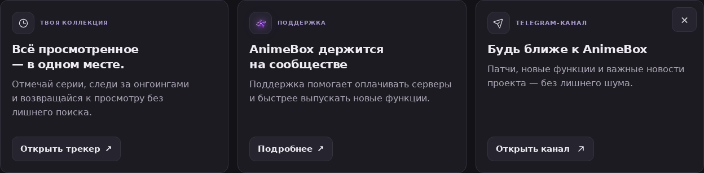
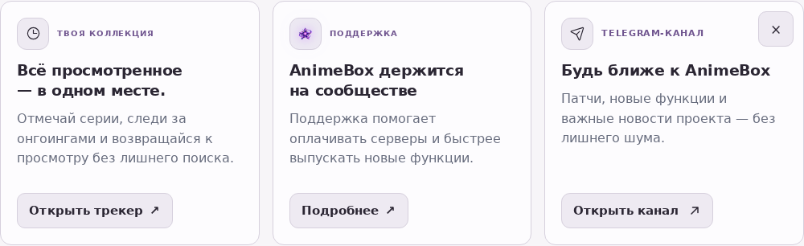

# Постеры расписания, Telegram-карточка и спокойная палитра

## Наблюдения

На двух скриншотах от 11 октября три карточки расписания показывают заглушку AnimeBox, четвёртая — постер. Telegram-карточка отличается от соседних: заголовок примыкает к шапке, лишняя подпись и плашки увеличивают визуальную плотность.

Проверка реальных запросов показала, что media Worker v5 отвечает `204`, `source-soft-fail`, `origin-403`. Репозиторий содержит Worker v6 с серверным резервом, но Git/Railway не публикует этот Worker. Для всех четырёх тайтлов серверный `/api/image` смог получить настоящие JPEG/PNG по `extraLarge`.

## Исправление постеров

1. Не подменять полноразмерный резервный адрес маленьким `medium` в tiny-слотах. Бюджет размеров успешного media-варианта остаётся 96/144/240.
2. Добавить серверный прокси для второго оригинального источника. Это ограниченная цепочка, без параллельного веера запросов и без поиска по названию.
3. Добавить параметр `fallback=error` для запросов из цепочки. При недоступном upstream прокси возвращает 502 с `no-store`, позволяя `img.onerror` перейти дальше. SVG с 200 ошибочно выглядел как успешная загрузка и останавливал резервные попытки.
4. Для старых запросов без параметра сохранить коротко кэшируемую SVG-заглушку. Ограничения доменов, редиректов, размеров ответа и rate limit сохраняются.

## Telegram

Использовать реальный внутренний flex-контейнер вместо `display: contents`, явный промежуток между шапкой и текстом, растяжение контейнера по высоте и кнопку у нижнего края. Footer получает одну подпись «TELEGRAM-КАНАЛ» и короткое действие «Открыть канал»; дублирующая английская подпись и две плашки убраны. В остальных размещениях содержимое сохраняется. Кнопка закрытия остаётся 44×44, закрытие и Telegram Mini App продолжают работать.

## Палитра

Тёмная тема: фон `#131217`, карточки `#1c1b22`, приподнятые элементы `#26242e`, рамки `#36333f`, текст `#edeaf2`, вторичный текст `#aca6b6`, акцент `#a798cf`. Снижается синий оттенок поверхностей и резкость границ. Светлая тема использует соответствующие нейтральные оттенки. Общие токены сохраняются, пользовательские темы профилей не переписываются.

## Проверка и границы

- Регрессии прокси: успешные изображения, старый SVG-fallback, явные ошибки для резервной цепочки, запрещённые адреса и редиректы.
- Реальные production-компоненты расписания: media/browser недоступны; все четыре постера должны загрузиться через серверный резерв оригинала.
- 22 сочетания темы и ширины: отсутствие переполнения, промежуток Telegram-шапка/текст минимум 12px, одинаковая нижняя линия кнопок при трёх колонках, закрытие карточки и клавиатурный фокус.
- Production build, TypeScript, targeted ESLint.

Обновление Cloudflare Worker до `media-shield-v6-origin-relay` остаётся отдельным инфраструктурным действием: файл `infra/cloudflare/media-worker.js`, настройка `MEDIA_ORIGIN_RELAY_ENABLED=true`. Это улучшит основной media-путь; резерв приложения должен работать и с текущим Worker v5. Нельзя считать логотип-заглушку настоящим постером или обещать восстановление каждого внешнего источника при одновременном отказе всех резервов.

## Предпросмотр

